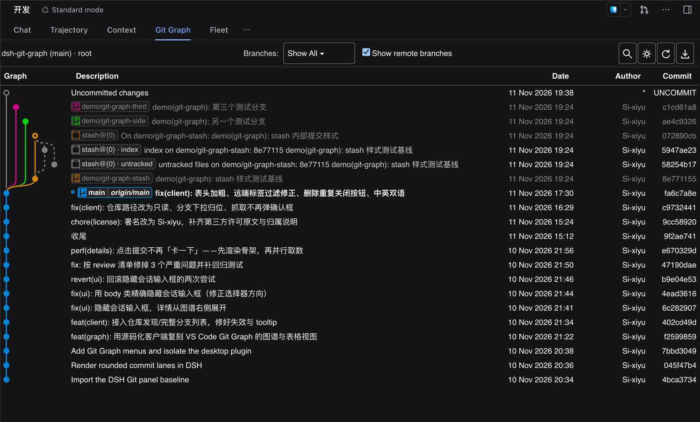
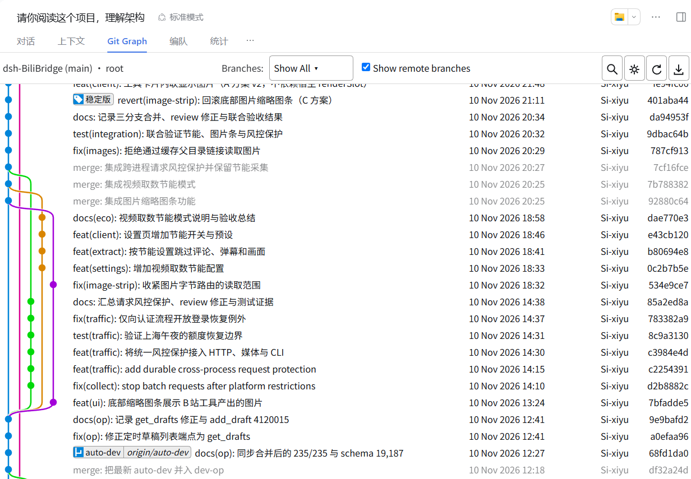
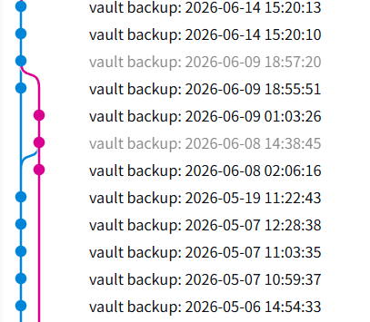

<p align="center"><strong>DSH Git Graph</strong> is a VS Code-style Git graph plugin for <a href="https://github.com/deepseek-ai/deepseek-harness">DeepSeek Harness</a> — commit history, branch actions and inline diffs, inside a session tab.</p>

<p align="center">
  
</p>

<p align="center">English | <a href="README.zh.md">简体中文</a></p>

---

DSH Git Graph turns the repository of the current session into a commit graph you can work on
without leaving the chat page: switch, create and delete branches, merge, rebase, reset,
cherry-pick, tag, stash, push and pull — with an inline commit details view and a diff drawer.

## Features

- **Commit graph** — branch-coloured lanes with per-row width, correct merge and side-branch
  routing. Stash commits (including their internal `index` / `untracked` entries) and the
  uncommitted-changes row are drawn distinctly; commits outside the checked-out branch are muted.
- **Reference pills** — local branches, remote branches and tags as compact pills, with the
  checked-out branch highlighted. Hover for a tooltip, double-click to check out.
- **Inline commit details** — author, committer, date, parents and the full message on the left;
  changed files with `+n / -n` on the right. Click a file to open its diff.
- **Diff drawer** — a resizable bottom panel with virtualised scrolling, per-file grouping and
  add/delete highlighting.
- **History actions** — checkout, create, rename, delete (optionally on remotes), merge, rebase,
  reset (soft / mixed / hard), cherry-pick, revert, drop a commit.
- **Tags and stashes** — create annotated or lightweight tags (optionally pushed), delete them
  locally or on a remote; push, apply, pop and drop stashes.
- **Remotes** — fetch (with prune options), push (normal / force-with-lease / force, set upstream),
  pull a specific remote branch.
- **Search and keyboard** — `Ctrl/⌘+F` search with highlighting, `Ctrl/⌘+R` refresh, `Ctrl/⌘+H`
  jump to HEAD, arrow keys to move (`Ctrl` / `Ctrl+Shift` for first / alternative parent–child).
- **Multiple repositories** — discovers repositories under the session directory and lets you switch.
- **Bilingual UI** — follows the host language, switchable in Preferences, remembered locally.

<p align="center">
  
  
</p>

## Quickstart

### Install with the DSH CLI (recommended)

```sh
dsh plugin --profile desktop add dsh-vsc-git-graph
```

Restart DSH Desktop, open a session inside a Git repository, and select the **Git Graph** tab.

### Install from a tarball (offline)

```sh
npm run dist
```

Then **Settings → Plugins → install from archive** and pick `dist/dsh-vsc-git-graph-<version>.tgz`.

### Install from source

```sh
git clone https://github.com/Si-xiyu/dsh-git-graph.git
dsh plugin --profile desktop add ./dsh-git-graph
```

<details>
<summary>Install from the plugin market</summary>

Once the plugin is listed in the [DSH plugin catalog](https://awesome-dsh-plugin.com), it can also be
installed from **Settings → Plugins → Discover** (dsh 0.2.1+). Add
`https://cdn.jsdelivr.net/npm/dsh-plugin-catalog/index.json` as an index source if the Discover tab is
empty.

</details>

### Let your agent install it

Paste this into your agent:

```text
Install the DSH Git Graph plugin from https://github.com/Si-xiyu/dsh-git-graph into my
DeepSeek Harness desktop profile.

1. Check prerequisites: `git --version` works, and `dsh --version` is >= 0.1.0-rc.5.
2. Install from npm: `dsh plugin --profile desktop add dsh-vsc-git-graph`.
3. If the npm registry is unreachable, clone the repo and install the local path instead:
   `git clone https://github.com/Si-xiyu/dsh-git-graph.git` then
   `dsh plugin --profile desktop add <absolute-path-to-the-clone>`.
4. Restart DSH Desktop, open a session inside a Git repository, and confirm a "Git Graph"
   tab appears in the session tab bar.
5. If anything fails, report the exact command, its stderr, and the `dsh` version.
```

Machine-readable install notes for agents: [AGENTS.md](AGENTS.md).

## Usage

- Open the **Git Graph** tab in a session — the graph follows that session's working directory.
- Click a commit to expand its details; click a file to open the diff drawer.
- Right-click a branch pill, commit, tag or stash for its actions.
- Double-click a branch pill to check it out.

## Requirements

- DeepSeek Harness Desktop ≥ 0.1.0-rc.5
- `git` on your `PATH`
- Node.js ≥ 20 (development and build only)

## Development

```sh
npm install
npm run build   # src/ -> lib/client.js (single-file client bundle)
npm test        # host + graph-engine + client bundle tests
npm run dist    # distributable tarball
```

The graph layout engine lives in `src/graph.js` and is specified behaviourally in
[`docs/GRAPH-SPEC.md`](docs/GRAPH-SPEC.md).

## License & credits

Released under the [MIT License](LICENSE) (© Si-xiyu).

- Baseline: [enoughpower/dsh-git-graph](https://github.com/enoughpower/dsh-git-graph) (MIT), license
  text in [`licenses/`](licenses/).
- The graph and its interactions are modelled after
  [VS Code Git Graph](https://github.com/mhutchie/vscode-git-graph). `src/graph.js` is an
  independent implementation written against a behavioural specification: behaviour matches the
  reference for visual parity, while the source text is not a copy.
- Per-path attribution: [THIRD_PARTY_NOTICES.md](THIRD_PARTY_NOTICES.md).
