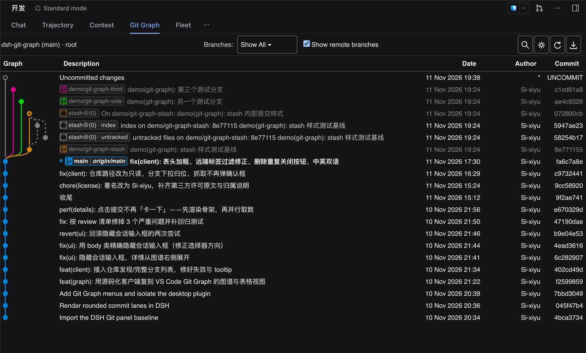
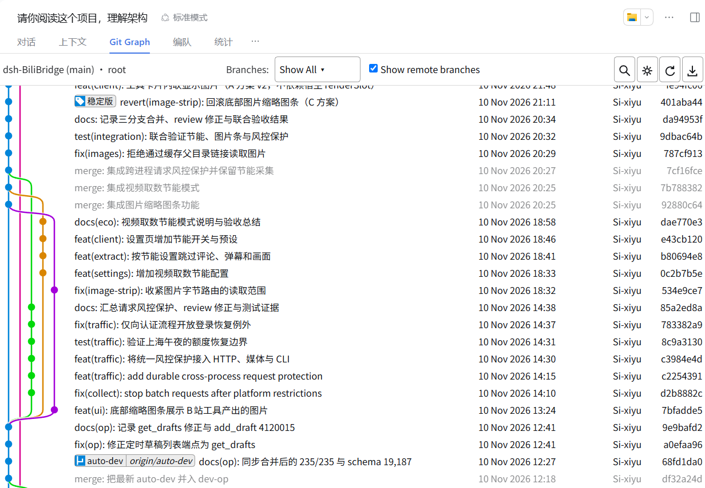
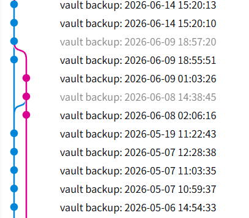

<p align="center"><strong>DSH Git Graph</strong> 是 <a href="https://github.com/deepseek-ai/deepseek-harness">DeepSeek Harness</a> 的 Git 图谱插件：在会话页签里看提交历史、直接做分支操作、内嵌查看差异。</p>

<p align="center">
  
</p>

<p align="center"><a href="README.md">English</a> | 简体中文</p>

---

DSH Git Graph 把当前会话所在仓库渲染成一张可操作的提交图：不用离开对话页，就能切换／新建／删除分支、
merge、rebase、reset、cherry-pick、打标签、stash、push、pull，并直接查看提交详情与文件差异。

## 功能

- **提交图谱**：分支级颜色、逐行宽度、正确的合并与旁支走线；stash 提交（含内部的 `index` /
  `untracked`）与未提交改动行有独立样式；不在当前分支上的提交变灰。
- **引用胶囊**：本地分支、远程分支、标签；当前分支高亮；悬停看提示，双击切换。
- **内嵌提交详情**：左侧作者／提交者／日期／父提交／完整说明，右侧变更文件与 `+n / -n`；点文件在抽屉里看差异。
- **差异抽屉**：底部可拖拽面板，虚拟滚动、按文件分组、增删底色。
- **历史操作**：切换、新建、重命名、删除（可同时删远端）、merge、rebase、reset（soft/mixed/hard）、
  cherry-pick、revert、丢弃提交。
- **标签与 stash**：附注／轻量标签（可同时推送）、本地或远端删除；stash 推送／应用／弹出／删除。
- **远端**：fetch（可清理失效引用）、push（普通／force-with-lease／force，可设 upstream）、拉取指定远程分支。
- **查找与键盘**：`Ctrl/⌘+F` 查找高亮、`Ctrl/⌘+R` 刷新、`Ctrl/⌘+H` 跳 HEAD、
  方向键移动（`Ctrl`／`Ctrl+Shift` 走首父／另一父）。
- **多仓库**：自动发现会话目录下的仓库，可切换。
- **中英双语**：跟随宿主语言，可在设置里切换，选择记在本地。

<p align="center">
  
  
</p>

## 快速开始

### 用 DSH CLI 安装（推荐）

```sh
dsh plugin --profile desktop add dsh-vsc-git-graph
```

重启 DSH Desktop，在 Git 仓库里的会话中打开 **Git Graph** 页签。

### 用压缩包安装（离线）

```sh
npm run dist
```

然后 **设置 → 插件 → 从压缩包安装**，选 `dist/dsh-vsc-git-graph-<版本>.tgz`。

### 从源码安装

```sh
git clone https://github.com/Si-xiyu/dsh-git-graph.git
dsh plugin --profile desktop add ./dsh-git-graph
```

<details>
<summary>从插件市场安装</summary>

插件被收录进 [DSH 插件目录](https://awesome-dsh-plugin.com)之后，也可以在
**设置 → 插件 → 发现**（dsh 0.2.1+）里一键安装。若「发现」页是空的，把
`https://cdn.jsdelivr.net/npm/dsh-plugin-catalog/index.json` 加为索引源。

</details>

### 让你的 agent 帮你装

把下面这段贴给 agent：

```text
请把 https://github.com/Si-xiyu/dsh-git-graph 这个 DSH 插件装进我的 DeepSeek Harness 桌面版 profile。

1. 先检查前提：`git --version` 可用，`dsh --version` >= 0.1.0-rc.5。
2. 从 npm 安装：`dsh plugin --profile desktop add dsh-vsc-git-graph`。
3. 如果 npm registry 不可达，改为本地安装：先 `git clone https://github.com/Si-xiyu/dsh-git-graph.git`，
   再 `dsh plugin --profile desktop add <克隆目录的绝对路径>`。
4. 重启 DSH Desktop，在 Git 仓库里的会话中确认页签栏出现 "Git Graph"。
5. 任何一步失败，请把完整命令、stderr 与 `dsh` 版本告诉我。
```

给 agent 的机器可读安装说明：[AGENTS.md](AGENTS.md)。

## 使用

- 在会话里打开 **Git Graph** 页签，图谱跟随该会话的工作目录。
- 点提交展开详情；点文件打开差异抽屉。
- 右键分支胶囊、提交、标签或 stash，弹出对应操作菜单。
- 双击分支胶囊即可切换。

## 环境要求

- DeepSeek Harness Desktop ≥ 0.1.0-rc.5
- `git` 在 `PATH` 中
- Node.js ≥ 20（仅开发与构建需要）

## 开发

```sh
npm install
npm run build   # src/ -> lib/client.js（单文件客户端产物）
npm test        # 宿主 + 图引擎 + 客户端产物测试
npm run dist    # 生成可分发压缩包
```

图谱布局引擎在 `src/graph.js`，行为规格见 [`docs/GRAPH-SPEC.md`](docs/GRAPH-SPEC.md)。

## 许可与来源

以 [MIT](LICENSE) 发布（© Si-xiyu）。

- 基线：[enoughpower/dsh-git-graph](https://github.com/enoughpower/dsh-git-graph)（MIT），
  许可原文在 [`licenses/`](licenses/)。
- 图谱与交互参照 [VS Code Git Graph](https://github.com/mhutchie/vscode-git-graph)；
  `src/graph.js` 是按行为规格独立实现的（行为对齐以保证视觉一致，源码文本不构成复制）。
- 逐路径归属：[THIRD_PARTY_NOTICES.md](THIRD_PARTY_NOTICES.md)。
